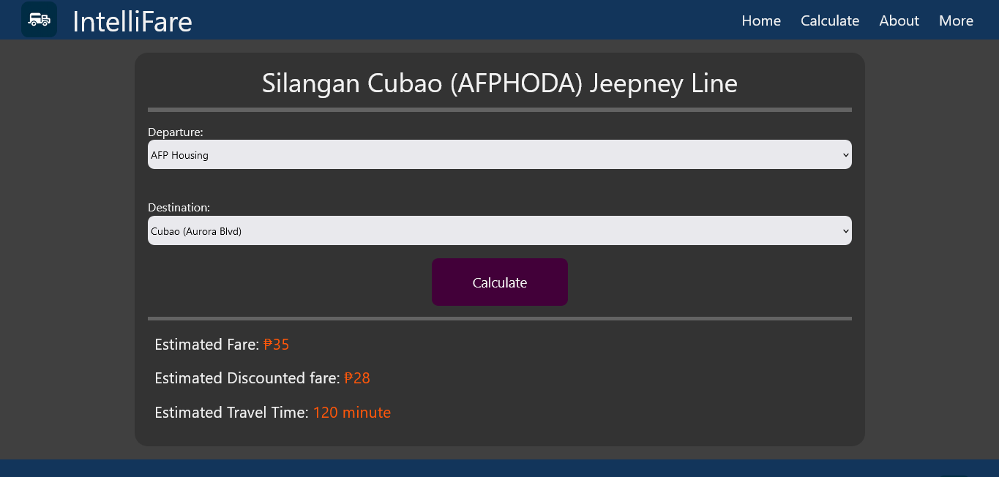

# IntelliFare

<a href="https://intellifare.netlify.app/"> <i>intellifare.netlify.app</i></a>

## 📌 About
**IntelliFare** is a web-based fare calculator designed for commuters traveling along the **Silangan–Cubao (AFPJODA) Jeepney route**.

The system allows users to select their starting point and destination to generate an **estimated fare, travel distance, and average travel time**. It is designed to make fare estimation more convenient and accessible for everyday commuters.

<blockquote>Note: Fare and travel-time results are estimates and may vary depending on official fare adjustments, traffic conditions, and actual travel circumstances.</blockquote>

## ✨ Key Features
-  **Estimated Fare Calculation**
Calculates the estimated fare for a selected route, including regular and discounted passenger fares.
- **Distance Estimation**
Calculates the estimated distance between the selected starting point and destination.
- **Average Travel Time**
Provides an estimated average travel time for the selected route.
- **User-Friendly Interface**
Provides a simple interface designed for quick and convenient fare estimation.

## 🔄 How It Works
1. Select your **starting point**.
2. Select your **destination**.
3. Click **"Calculate"**.
4. IntelliFare calculates the estimated **fare and distance**.
5.  The system displays the **estimated travel time**    for the selected route.

## 🛠️ Technologies & Services

**Core**
- HTML5
- CSS3
- JavaScript

**Libraries & Frameworks**
- Bootstrap
- AOS (Animate On Scroll)
- Font Awesome
- Google Fonts

**Infrastructure**
- Netlify
- jsDelivr
- unpkg

**Web & Security Standards**
- HTTP/2
- HSTS

## 🖥️ Preview

  

## 📄 Disclaimer
<blockquote>IntelliFare is intended to provide <strong>estimated</strong> fare, distance, and travel-time information for the supported route. Actual fares and travel times may differ due to official fare changes, traffic conditions, route changes, and other circumstances.</blockquote>